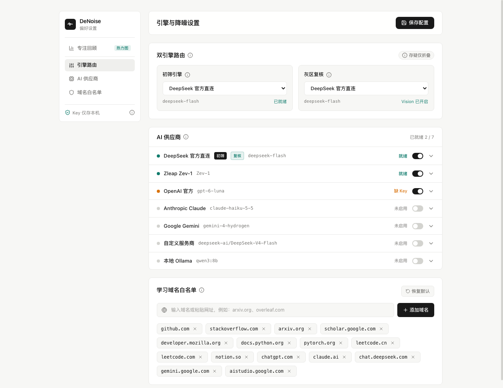

# DeNoise — AI 网页注意力主动降噪器

> **像 AirPods 主动降噪（ANC）抵消环境噪音一样，识别你当下的学习与科研任务，用 AI 实时把网页里的算法投喂噪音与杂乱标签页静默消融，并把你的专注过程沉淀为可复盘的本地热力图与小票档案。**

---

## 1. 界面预览

> 注：实机动态演示 GIF 将在后续版本补充，当前先附上 `v1.1.0` 最新页面截图。

| DeNoise 主动降噪舱（Popup） | 专注回顾与 53 周热力图（Options） |
|:---:|:---:|
|  |  |

<details>
<summary>展开查看：双引擎路由、7 家 AI 供应商与白名单配置页</summary>



</details>

---

## 2. v1.1.0 新增与核心能力

### 2.1 开局一键语义整理标签页（Semantic Tab Grouping）
- **自动识别并着色归组**：开启专注后，后台对当前已打开标签页及后续新开标签页自动分类，按 4 类学习语义建立 Chrome Tab Group：
  - `🎬 视频课程`（cyan）
  - `💻 代码与文档`（blue）
  - `🔍 检索与问答`（green）
  - `📄 文献与笔记`（purple）
- **无关页温和折入或安全清理**：与任务无关的娱乐/信息流标签在标准模式下自动折入灰色的 `💤 暂存休息舱`；强力模式下先截取关闭前网页快照存档进《🛡️ 防误杀黑匣子》，再安全关闭并支持随时一键恢复全部分组与标签。

### 2.2 专注回顾仪表盘与 53 周热力图
- **多时间范围统计**：提供「今天 / 近 7 天 / 近 30 天 / 近 1 年 / 全部」视图，统计总专注时长、平均环境信噪比（SNR）、拦截/召回页数，以及本周 Pro 激励打卡进度（`300 min` 目标进度条与连续专注天数）。
- **53 周专注热力图**：支持切换「时长 / 信噪比 / 次数」热度维度，点击任意日期方块即可联动筛选下方明细，并配合「近 14 天专注节奏」柱状图。
- **AI 周期复盘 & 高清小票导出**：内置 DeepSeek 周期复盘生成，每条专注记录均支持导出 2× Retina 高清《DeNoise 降噪结算小票》PNG 与 Markdown 复盘块。

### 2.3 双引擎协同 + 7 家 AI 供应商 + 4 层降噪漏斗
- **多引擎灵活接入**：默认内置 **DeepSeek V4.1-Flash (`deepseek-flash`)** 与 **Zleap `Zev-1` System-1 判别模型**，同时支持 OpenAI、Anthropic Claude、Google Gemini、自定义服务商（OpenAI / Anthropic / Gemini 格式切换 + `/models` 拉取）以及本地 Ollama 节点；未配置或断网时自动退回本地词簇语义兜底。
- **4 层行为响应漏斗**（详见 [`docs/USER_BEHAVIOR_MATRIX.md`](./docs/USER_BEHAVIOR_MATRIX.md)）：
  1. **L1 域名直通/拦截（`< 1ms`）**：抖音/微博/淘宝等直接收舱，GitHub/arXiv/LeetCode/AI 问答站直通归组。
  2. **L2 内容启发式（`< 5ms`）**：对 B 站、YouTube、知乎、搜索引擎等混合平台做标题与搜索词初筛。
  3. **L3 LLM 语义判别**：由初筛引擎对卡片和标签做相关性打分与归类。
  4. **L4 多模态看图防误杀**：后台定时缓存活跃标签缩略图，强力模式遇到标题空白或灰区（`15% ~ 60%`）页面时调用 Vision 看图复核，存疑只折叠不关闭。
- **网页内两层降噪外科手术**：
  - **硬噪音秒切**：动态注入站点去噪 CSS，清理热搜榜、侧边栏推荐与弹窗，并将视频评论区折叠为静音开关条。
  - **动态毛玻璃遮罩**：`MutationObserver` + `300ms` 防抖增量扫描推荐流，相关卡片打上 `🎯 任务相关` 徽标，无关诱惑卡片平滑施加 `blur(11px) grayscale(85%)` 遮罩，提供 `[ 👁 临时查看 ]` 与 `[ 📌 标为资料 ]`。
- **三级专注强度 + 偏航轻提示**：
  - **🌱 温和模式**：仅做网页内毛玻璃降噪，不移动任何标签页。
  - **⚖️ 标准模式**：自动整理学习分组 + 将无关页折叠进 `💤 暂存休息舱`。
  - **🔥 强力模式**：多模态复核后自动关闭纯娱乐页并写入《🛡️ 防误杀黑匣子》；在低相关页面停留 ≥ 2s 时触发顶部轻提示，支持「确认偏离并切回 / 仅切回 / 误判标为资料」。

---

## 3. 下载安装与本地构建

### 方式 A：直接下载预打包版本（推荐）

1. 前往本仓库的 [Releases 页面](https://github.com/tangdoou/DeNoise/releases) 下载最新 `DeNoise-v*-chrome.zip` 并解压
2. 打开 Chrome 访问 `chrome://extensions/`
3. 开启右上角 **开发者模式 (Developer mode)**
4. 点击 **加载已解压的扩展程序 (Load unpacked)**，选择解压后的目录即可使用

> 本地加载无需开发者证书，也无需上架 Chrome 应用商店。

### 方式 B：从源码构建

`dist/` 是本地构建产物，**不提交到 Git 仓库**。首次使用请先配置本地 Key 并构建：

```bash
# 1. 安装依赖
npm install

# 2. 配置本地 Key（.env.local 已被 gitignore）
cp .env.example .env.local
# 编辑 .env.local，填入 VITE_DENOISE_DEEPSEEK_KEY（可选同时填入 VITE_DENOISE_ZLEAP_KEY）

# 3. 类型检查与生产构建
npm run typecheck
npm run build
```

构建完成后，在 Chrome 加载本项目根目录下的 `dist/` 文件夹即可。完整步骤与排障见 [`docs/BUILD_AND_INSTALL.md`](./docs/BUILD_AND_INSTALL.md)。

---

## 4. 项目结构与延伸文档

```text
src/
├── background/        # Service Worker、4 层判别引擎、标签语义编组与黑匣子治理
├── content/           # 站点适配器、两层 DOM 降噪器、Shadow DOM 悬浮胶囊 / 偏航条 / 结算小票
├── options/           # 设置中心（引擎路由 / 7 家供应商 / 白名单）与专注回顾热力图面板
├── popup/             # 主动降噪舱弹窗、今日/周/月/年账本与 ANC 波形
└── shared/            # 域名规则、AI 预设、Chrome 存储管理与 2× Retina 小票 PNG 导出器
```

- [`docs/BUILD_AND_INSTALL.md`](./docs/BUILD_AND_INSTALL.md) — 构建、环境变量与本地安装说明
- [`docs/USER_BEHAVIOR_MATRIX.md`](./docs/USER_BEHAVIOR_MATRIX.md) — 用户行为 × 产品响应 4 层矩阵
- [`docs/ZLEAP_ZEV1_INTEGRATION.md`](./docs/ZLEAP_ZEV1_INTEGRATION.md) — Zleap Zev-1 System-1 接口接入与限流配置说明
